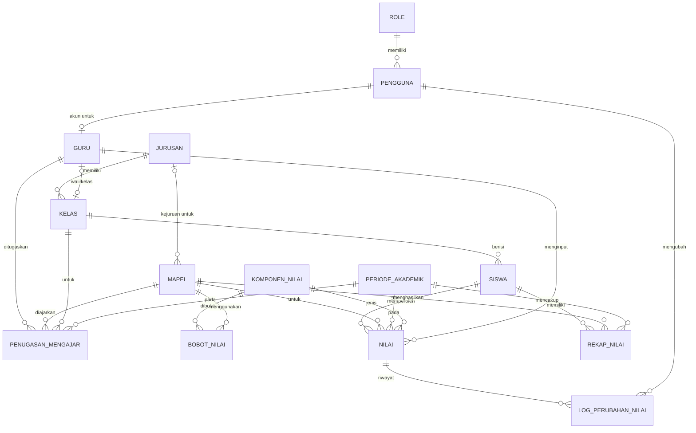

# ERD Revisi — Sistem Informasi Nilai Akademik (Web, ASP.NET Core MVC)

Dasar: `ERD.pdf` (9 entitas) dicocokkan dengan SRS Kelompok 4 (FR-01..FR-11, NFR-01..07) dan `list_user.docx`.
Hasil: 9 entitas lama diperbaiki, 6 entitas baru ditambahkan (JURUSAN, GURU, KELAS, PENUGASAN_MENGAJAR, LOG_PERUBAHAN_NILAI, RENTANG_NILAI_HURUF) → total 15.

## 1. Kekurangan yang ditemukan pada ERD lama

| # | Temuan | Acuan | Perbaikan |
|---|--------|-------|-----------|
| 1 | Judul ERD "Application Mobile", padahal SRS = aplikasi web | SRS 1.2 | Ganti judul jadi ERD aplikasi web |
| 2 | Tidak ada tabel **GURU** (NIP/NRG, akun terkait) | FR-03 | Tambah `GURU`, relasi 1:1 ke `PENGGUNA` |
| 3 | Tidak ada tabel **KELAS** dan wali kelas | FR-05 | Tambah `KELAS` (+ `JURUSAN`); `SISWA.id_kelas` |
| 4 | `SISWA` hanya punya nis, nama, status | FR-02 | Tambah nisn, jenis_kelamin, tanggal_lahir, alamat, id_kelas |
| 5 | Tidak ada penugasan guru → mapel → kelas → periode | FR-06 ("hanya guru dengan penugasan terkait") | Tambah `PENUGASAN_MENGAJAR` |
| 6 | Tidak ada riwayat perubahan nilai | FR-07, NFR-01 | Tambah `LOG_PERUBAHAN_NILAI` |
| 7 | Rentang nilai huruf tidak tersimpan, `REKAP_NILAI` tanpa nilai huruf | FR-09 ("dapat disesuaikan") | Tambah `RENTANG_NILAI_HURUF`, kolom `nilai_huruf` di rekap |
| 8 | `BOBOT_NILAI` tidak menunjuk komponen mana yang dibobot; `KOMPONEN_NILAI` memuat `id_mapel` (komponen jadi duplikat per mapel) | FR-08 | `KOMPONEN_NILAI` jadi master (HARIAN/UTS/UAS); `BOBOT_NILAI` = (mapel, komponen, persentase) |
| 9 | `NILAI` punya `id_rekap` → melingkar (rekap dihitung dari nilai, tapi nilai butuh rekap dulu) | FR-06, FR-08 | Hapus `id_rekap` dari `NILAI`; tambah `id_mapel`, `id_periode`, `id_guru_penginput`, unique (siswa, mapel, periode, komponen) |
| 10 | `PERIODE_AKADEMIK` tanpa tahun ajaran/semester/aktif | SRS 2.5 | Tambah tahun_ajaran, semester, status aktif |
| 11 | `PENGGUNA.password` ambigu | FR-01 ("ter-hash") | Ganti nama `password_hash` |
| 12 | `MAPEL` tanpa kelompok (Umum/Kejuruan) | FR-04, list_user | Tambah `kelompok`, `id_jurusan` (nullable) |
| 13 | Tidak ada penanda hapus lunak | FR-02/03/04 ("tidak dihapus permanen jika punya nilai") | Kolom `status`/`is_active` pada SISWA, GURU, MAPEL, KELAS |
| 14 | Unique constraint belum tertulis | FR-02, 03, 04, 06 | Lihat bagian 3 |

## 2. Diagram (Mermaid)

## 3. Rincian entitas (acuan untuk Models C#)

PK = primary key, FK = foreign key, UQ = unique. Nama kolom Inggris/Indonesia di C# mengikuti PascalCase dari nama ini (mis. `id_siswa` → `Id` atau `IdSiswa`; pilih satu gaya dan konsisten).

**ROLE** — id_role PK; nama_role UQ (ADMIN, GURU, WALI_KELAS)

**PENGGUNA** — id_pengguna PK; id_role FK; nama; username UQ; password_hash; status (Aktif/Nonaktif); dibuat_pada

**JURUSAN** *(baru)* — id_jurusan PK; kode UQ (TKJ, MPLB, AKL, TE, TBSM); nama

**GURU** *(baru)* — id_guru PK; id_pengguna FK UQ (1:1); nip_nrg UQ nullable (MySQL mengizinkan banyak NULL pada unique index; kosong di data awal karena tidak ada di list_user); nama; status

**KELAS** *(baru)* — id_kelas PK; nama_kelas UQ (mis. "XI TKJ"); tingkat (X/XI/XII); id_jurusan FK; id_wali_kelas FK → GURU, UQ (satu guru hanya wali satu kelas); status

**SISWA** *(diperluas)* — id_siswa PK; nis UQ; nisn UQ; nama_siswa; jenis_kelamin; tanggal_lahir; alamat; id_kelas FK; status

**MAPEL** *(diperluas)* — id_mapel PK; kode_mapel UQ; nama_mapel; kelompok (Umum/Kejuruan); id_jurusan FK nullable; deskripsi; status

**PERIODE_AKADEMIK** *(diperluas)* — id_periode PK; nama_periode; tahun_ajaran (mis. 2026/2027); semester (Ganjil/Genap); tanggal_mulai; tanggal_selesai; status (Aktif/Nonaktif)

**PENUGASAN_MENGAJAR** *(baru)* — id_penugasan PK; id_guru FK; id_mapel FK; id_kelas FK; id_periode FK; UQ (id_guru, id_mapel, id_kelas, id_periode)

**KOMPONEN_NILAI** *(diubah)* — id_komponen PK; nama_komponen UQ (Harian, UTS, UAS); jenis_penilaian (HARIAN/UTS/UAS)

**BOBOT_NILAI** *(diubah)* — id_bobot PK; id_mapel FK; id_komponen FK; persentase decimal(5,2); UQ (id_mapel, id_komponen). Aturan: jumlah persentase per mapel = 100 (divalidasi di layanan, bukan di DB). Default 30/30/40.

**NILAI** *(diubah)* — id_nilai PK; id_siswa FK; id_mapel FK; id_periode FK; id_komponen FK; nilai decimal(5,2) CHECK 0–100; tanggal_penilaian; id_guru_penginput FK; diubah_pada; UQ (id_siswa, id_mapel, id_periode, id_komponen)

**LOG_PERUBAHAN_NILAI** *(baru)* — id_log PK; id_nilai FK; nilai_lama; nilai_baru; id_pengguna FK; waktu_perubahan; alasan nullable

**RENTANG_NILAI_HURUF** *(baru)* — id_rentang PK; huruf UQ; nilai_min decimal(5,2). Data awal: A=85, B=75, C=60, D=0. Huruf = baris dengan nilai_min terbesar yang ≤ nilai akhir.

**REKAP_NILAI** *(diperluas)* — id_rekap PK; id_siswa FK; id_mapel FK; id_periode FK; nilai_akhir decimal(5,2) (pembulatan 2 desimal); nilai_huruf; tanggal_perhitungan; status; UQ (id_siswa, id_mapel, id_periode)

Aturan FK: gunakan `DeleteBehavior.Restrict` (tidak ada cascade ke NILAI/REKAP) agar data bernilai tidak terhapus permanen.

## 4. Usulan tambahan pada SRS (bagian "perancangan")

SRS FR-01..FR-11 belum mencakup hal berikut, padahal disebut di bagian lain SRS atau di `list_user.docx`:

- **FR-12 Manajemen Periode Akademik** — disebut di SRS 2.5 dan dipakai semua transaksi, tetapi tidak punya FR.
- **FR-13 Konfigurasi Bobot & Rentang Nilai Huruf** — SRS 3.2 dan FR-09 menyatakan "dapat diubah", tetapi belum ada fitur pengubahnya.
- **FR-14 Dasbor & Rekap Nilai** — `list_user.docx` memberi hak akses "Dashboard" dan "Rekap Nilai" ke Guru dan Wali Kelas; SRS 1.3/4.3 menyebut rekap, tetapi tidak ada FR khusus.
- **FR-15 Penugasan Guru** — pengelolaan `PENUGASAN_MENGAJAR` oleh Admin (dasar aturan FR-06).
- Koreksi kecil: SRS menyebut pengguna login dengan "username/email", sedangkan data akun hanya punya username → tetapkan username saja.

## 5. Catatan data awal (`list_user.docx`)

- Total 36 akun: 2 Admin, 14 Guru Umum, 5 Guru Kejuruan, 15 Wali Kelas. Bagian "Akun Administrator" tidak punya judul/hak akses di dokumen (hanya tabelnya); diasumsikan akses penuh.
- Kata sandi di dokumen berupa teks biasa. Saat seeding **wajib di-hash**; jangan simpan teks biasa di database.
- Wali kelas memiliki hak Input Nilai dan Cetak Rapor → peran WALI_KELAS menyertakan hak Guru.
- Mata pelajaran wali kelas diasumsikan diajarkan di kelas yang mereka walikan; guru kejuruan non-wali di kelas yang tertulis di kurung.
- Nama lengkap jurusan (TKJ, MPLB, AKL, TE, TBSM) tidak tertulis di dokumen; lihat `AGENTS.md`, mohon dikonfirmasi.
